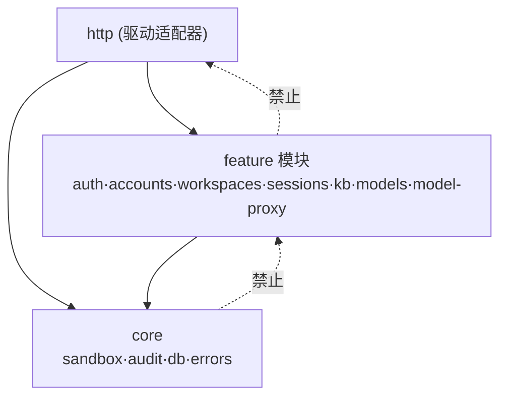
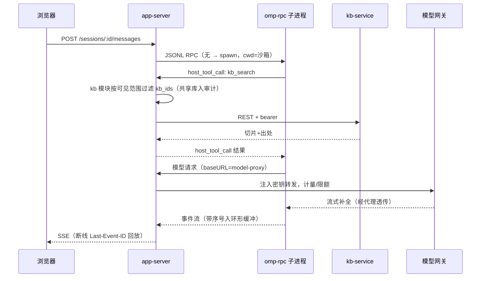

# 系统架构 — open-workbuddy

> 2026-08-29。顶层架构：模块图、依赖规则、目录结构、数据流。
> 输入：`PLAN.md`（建什么/分几步）、`CONTEXT.md`（术语与不变量）、`docs/adr/0001`–`0008`（决策）。
> 行为基准是 live demo；本文只定形状，模块内部接口细化到实现时再做。

## 1. 范围与目标

覆盖整个系统的顶层分解：app-server / web SPA / kb-service 三个自研组件的模块图与相互契约，
以及 omp 子进程、模型网关、Infinity 的接入方式。不含：模块内部详细接口、数据库 schema、
API 端点清单（属 spec 阶段）。

## 2. 约束

- 内网单机部署包（P4），无公网依赖；部署包带 fuse3 + rclone（ADR-0003）。
- omp 钉住官方二进制 v18.12.3（ADR-0001 2026-10-20 补充；原 fork 冻结方案作废），只经 stdio JSONL RPC 驱动。
- omp 与 kb-service 不感知租户；多租户逻辑全在 app-server（PLAN §2 决策 3）。
- CONTEXT.md 五条不变量，尤其：凭证不进 omp 环境（不变量 4）、沙箱越界拒绝+审计（不变量 3）。
- `app-reference/` 只读参照，内容不进产物。

## 3. 模块图

### 3.1 app-server（TS/Node，模块化单体）

术语按 deep-modules：**接口** = 调用方须知的全部；**接缝背后** = 被隐藏的复杂度。

| 模块 | 接口 | 接缝背后 | 深度理由（删除测试） |
|---|---|---|---|
| `core/sandbox` | `createSandbox({rootOf, audit}) → { resolve(principal, workspaceId, relPath, op: "read"\|"list"\|"mkdir") → 绝对路径 \| 拒绝, ensureSharedDir }`（`rootOf` 由 workspaces 实现：返回 null → `not_found` 且不审计；越界先经 `core/audit` 记 `sandbox.reject` 再抛 `sandbox_denied`）；`deriveWhitelist(workspace) → omp 沙箱配置`（S1b 未来项，未实现） | 路径规范化、symlink 逃逸防御；多根挂载点合并、白名单推导（排除 app-server 配置）为 S1b 未来项 | 删掉它，越界防御在 workspaces/sessions/kb 每个调用点重现——AGENTS.md 白盒关键路径 |
| `core/audit` | `emit(db, event)`；`query(db, principal, {limit?, before?})` | 只追加表、账号隔离、canonical id 游标分页 | 所有模块的合规出口收敛于一处 |
| `core/errors` | `HttpError`、十六码与中文消息（含 `sandbox_denied`/`conflict`/`preview_too_large`/`preview_unsupported`） | HTTP 状态码、content-parser 归属与信封映射仍在 `http/` | 一处运行时身份，避免 core 反向依赖 http |
| `core/db` | SQLite 句柄 + 迁移执行 | WAL 配置、schema 迁移（ADR-0004） | |
| `auth` | `authenticate(req) → Principal`；login/callback/logout 路由 | OIDC 流程、会话 cookie、首登 provisioning；适配器×2：oidc、dev-stub（ADR-0007） | 两个适配器 = 真接缝 |
| `accounts` | 账号属性/角色/配额/项目组管理；`scopeOf(principal)` → 可见范围解析输入 | IdP 字段与应用侧字段的分界 | |
| `workspaces` | 空间 CRUD、树列举、文件读/预览、挂载 attach/detach/status | `mounts/` 子模块 = mount-manager：rclone/sshfs 进程生命周期、凭证保管、健康探测、崩溃重挂（ADR-0003）；多根树合并；S1f change C（`s1f-session-list-temp-space`）：临时空间（`workspaces.temporary` 标记，目录名 `tmp-<id>`；随会话在同一事务里创建，`GET /api/workspaces` 不列出、按 id 的端点照常可达）、`POST /api/workspaces/:id/promote`（原地转正：只改名字与标记，目录不动，`workspace.promote` 审计）、`temp-dir-remove.ts`（临时空间目录经 app 私有 trash 中转删除，`EXDEV` 时原地删）、`snapshots.ts`（回合快照的落盘 `take` 与两种目录删除）与 `snapshots-restore.ts`（还原）——快照根目录由 `createApp` 注入，这两个模块不导入 `sessions/`，也没有自己的路由（部署侧见 §9.1） | 挂载协议差异（SFTP/NFS/SMB）全部藏在接缝后 |
| `sessions` | `create/resume/fork/list`；`post(input)`；`interrupt()`；`subscribe(lastEventId) → 事件流` | omp-supervisor（每活跃会话 spawn、空闲回收、全局上限 `OMP_MAX_PROCESSES`（默认 16）/ 触顶驱逐最久空闲进程（无可驱逐 → `agent_capacity`）、并发 spawn 上限 `OMP_SPAWN_CONCURRENCY`（缺省 CPU 数；准入后 FIFO 排队、排队不计入握手 deadline，握手超时写一行 stderr 记录；保留的基础设施故障与会话删除清理失败各写一行 `{"event":"session_fault"}`）、审批经 host 应答（`approval.request`/`approval.resolved`，`chat_approvals` 持久化））、JSONL RPC 编解码、`host_tool_call` 分派、事件序号+环形缓冲（ADR-0006）、SQLite 会话/消息/步骤存储（持久历史事实源；实时缺口恢复使用 store 自有待刷尾部补齐的完整快照及同刻 streamCursor，读取不改变刷盘策略——#214）；omp `.jsonl` 存于 app-server 托管的 `OMP_STATE_DIR`、只供 `--resume`（S0b grill 2026-09-18）；S1c change B：会话可绑定工作空间（绑定会话的 omp cwd 为该空间根，`session.bind` 审计）、元数据 `PATCH /api/sessions/:id`（标题 / 场景 / 置顶）与 `DELETE /api/sessions/:id`（`session.delete` 审计）、`thinking.delta` 与 `files.changed` 事件（分别持久化到 `chat_messages.thinking` 与 `chat_steps.changes`）、`MODEL_REASONING`（托管 `models.yml` 的模型条目是否声明 reasoning；只影响 omp 的请求侧，不门控宿主对 thinking 的解析）、slash 白名单与 `GET /api/commands`（白名单外以 `/` 开头的文本转义后送模型）；S1f：任务清单（omp `todo` 工具结果的全量清单归一化后持久化到 `chat_sessions.todo`，经 `todo.updated` 事件与消息快照顶层 `todo` 下发；结构不合规的候选丢弃并写一行不含任务文本的 stderr warn 记录）；S1f change C（`s1f-session-list-temp-space`）：会话视图十一键（增 `archivedAt`、`pendingApproval`、`temporaryWorkspace`，`store-view.ts`）；`PATCH /api/sessions/:id` 增 `archived` 键，已归档会话的 prompt / 重新生成 / fork / 撤回以 409 `session_archived` 拒绝；不带 `workspaceId` 的 `POST /api/sessions` 同事务创建临时空间，`DELETE /api/sessions/:id` 在它是最后一个使用者时连同临时空间的行、目录与快照一起删（`workspace.delete` 审计）；列表事件连接 `GET /api/sessions/events`（`list-events.ts`：按账号的通知器与 SSE 路由，只发 `sessions.changed` 与 `session.rewound`，无序号、无回放，见 §9.2）；受理 prompt 后、派发前的回合快照步骤（`turn-snapshot.ts`，经 `supervisor.prompt` 的 `beforeDispatch`；登记表 `chat_turn_snapshots` 只由 `store-undo.ts` 读写）；撤回 `POST /api/sessions/:id/undo`（`undo.ts`：body `{messageId, files}`，`files` 为 `keep` / `restore` / `force`；临时进程上 `branch` 后原地回退对话并可还原文件，冲突为 409 `undo_conflict`，`session.undo` 审计；与 fork 共用 `branch-temp.ts` 的对位与临时进程）；消息视图与 prompt 202 增 `undo` 键 | omp 协议与进程治理全部不外泄；调用方只见会话语义 |
| `kb` | `search(principal, query, kbRefs) → 切片+出处`；center 管理透传 | 可见范围过滤（先过滤 kb_ids 再调 kb-service）、bearer 凭证、共享库检索审计 | host tool 与 UI 检索共用同一过滤路径 |
| `models` | 模型注册表 CRUD + 探活（对话/嵌入/重排） | 网关寻址细节 | |
| `model-proxy` | 对 omp：baseURL + 会话标识；OpenAI 兼容端点 | 注册表寻址、密钥注入、流式透传、计量/限额、审计（ADR-0008） | 不变量 4 的机械保障点 |
| `http` | Fastify 路由、中间件、SSE 端点；状态码与错误信封映射 | 纯驱动适配器层，零业务 | |

### 3.2 kb-service（Python，吸收 RAGFlow）

| 模块 | 接口 | 接缝背后 |
|---|---|---|
| `api` | REST + bearer 鉴权（每请求必验，不变量 4 配套） | FastAPI 路由 |
| `ingest` | 提交文档 → 任务状态 | deepdoc 解析（模型本地路径）、12 模板切片、任务队列 |
| `retrieval` | `search(kb_ids, query, params) → 切片+出处` | 混合检索、重排、agentic 环（改写→召回→充分性→二轮） |
| `store` | RAGFlow `DocStoreConnection` | Infinity 适配（ADR-0005），保留 ES 退路 |
| `embedding` | 内部客户端 | 直连模型网关（凭证在 kb-service 配置，合规） |

kb-service 只认 kb_id 集合，不认用户——租户过滤是 app-server `kb` 模块的职责。

### 3.3 web SPA（React + Vite）

路由镜像 demo IA：`/`、`/files`、`/center`（扁平路由，8 tab 为页内状态，S1d 需深链时再引入 query 参数）、`/settings`。横切：`lib/api`（REST 客户端）、
`lib/sse`（Last-Event-ID 重连）、`lib/theme`（已有）、`lib/session-list-events`（列表事件连接 `GET /api/sessions/events` 的连接器，S1f change C）。每路由一个 feature 目录，不做全局状态库，
按需 React context。

组件分两层（ADR-0013）。拷入层是 `web/src/components/ui/`（shadcn/ui registry 的组件，交互行为来自合包
`radix-ui`）与 `web/src/components/assistant-ui/`（assistant-ui registry 的三个会话面组件及其依赖），原样拷入、
只允许规格列出的几类修改。其余都是应用层：feature、路由，以及直接放在 `web/src/components/` 下的自写共享组件
`icon.tsx`（图标，取自 lucide-react）、`brand-mark.tsx`（品牌 mark）与 `escape-fallback.ts`（覆盖层的 Escape
兜底）；这一层没有统一出口文件，使用方直接从各文件导入，也不直接依赖 Radix。原先的 `web/src/ui` 基元层
已删除（change `s1f-legacy-layer-removal`，#1393）。

样式只有三个文件：入口 `web/src/styles.css`（层声明 `@layer theme, base, components, utilities;`、Tailwind
三段与全局 reduced-motion 块）、`web/src/styles/tokens.css`（调色板 + 语义层，亮/暗两套）、
`web/src/styles/theme.css`（shadcn 语义变量到 token 的映射，外加一个 `@layer base` 块承载全局基础规则与
`ui-*` 类）。应用代码只写 Tailwind 类与主题变量，不新增 `.css`；demo 中没有后端契约的控件不渲染。

## 4. 依赖规则



1. 方向单向：`http → feature → core`。http 可直接依赖 core（共享错误身份）；core 不 import feature/http，feature 不 import http。
2. feature 之间只允许显式声明的依赖：`sessions → kb`（host tool 分派）、`sessions → workspaces`（仅两处：`sessions/session-delete.ts` 导入 `workspaces/temp-dir-remove.ts` 的目录删除；`sessions/prompt-attachments.ts` 导入 `workspaces/store.ts` 的错误类 `WorkspaceRootOccupiedError`，只用来辨认注入的 `workspaceRootOf` 抛出的「根被非目录占据」（#1257）。取根本身与快照服务仍经 `app.ts` 注入，不直接导入）、`workspaces/sessions/kb → core/sandbox`、`kb → accounts`（可见范围）。其余一律经 core。`server/src/preview/app.ts`（预览监听器）是与 `server/src/app.ts` 同层的第二个装配根，与后者一样可直接导入 `workspaces`、`http` 与 core；`preview/` 下的其余文件不在此列。
3. **一切文件路径操作必须经 `core/sandbox.resolve`**；feature 模块直接 `fs` 访问用户路径是缺陷。
4. omp 与 kb-service 之间无直连——KB 检索必走 `host_tool_call → app-server kb 模块` 转发。
5. 跨服务契约（app-server↔kb-service）语言中立 REST，不共享代码。

（AGENTS.md 已知盲区：模块 import 边界暂无机械检查，依赖规则靠评审；引入 dependency-cruiser 时以本节为规则源。）

## 5. 目录结构

```
server/src/
├── app.ts               # 可注入装配：auth → http guard → model-proxy → sessions；不 listen/关 DB
├── server.ts            # 唯一生产入口：配置 → DB → app → 预览 listen → listen；持有 DB 生命周期
├── agent-config.ts      # app/入口共用的纯 agent 配置与默认值，无环境读取或 IO
├── core/
│   ├── db/              # SQLite 打开 + 迁移
│   ├── audit/           # emit/query，只追加
│   ├── errors/          # 共享 HttpError、codes、messages
│   └── sandbox/         # resolve、白名单推导
├── auth/                #   providers/oidc.ts、providers/dev-stub.ts
├── accounts/
├── workspaces/
│   ├── snapshots.ts          # 回合快照落盘（take）与快照目录删除
│   ├── snapshots-restore.ts  # 按快照清单还原工作空间
│   ├── temp-dir-remove.ts    # 临时空间目录经 trash 删除
│   └── mounts/               # mount-manager（rclone/sshfs 生命周期）
├── sessions/
│   ├── supervisor.ts    # runtime、事件映射与持久化编排
│   ├── index.ts         # 会话模块注册、对账与资源回收
│   ├── list-events.ts   # 列表事件通知器与 GET /api/sessions/events
│   ├── store-view.ts    # 会话视图（十一键）的列集与映射
│   ├── turn-snapshot.ts # 受理 prompt 后、派发前的快照步骤
│   ├── store-undo.ts    # 快照登记行读写、冲突判定、撤回事务
│   ├── undo.ts          # 撤回编排与 POST /api/sessions/:id/undo
│   ├── branch-temp.ts   # fork 与撤回共用的对位、branch 与临时进程
│   ├── omp/             # 子进程生命周期 + JSONL RPC 编解码
│   └── stream/          # 事件序号、环形缓冲、SSE 回放
├── kb/                  # 可见范围过滤 + kb-service 客户端
├── models/              # 注册表 + 探活
├── model-proxy/
└── http/                # 路由、中间件、SSE 端点

kbservice/src/kbservice/
├── api/                 # FastAPI + bearer 中间件
├── ingest/              # deepdoc + 模板切片 + 任务队列
├── retrieval/           # 混合检索 + agentic 环
├── store/               # DocStoreConnection → Infinity
└── embedding/           # 模型网关客户端

web/src/
├── routes/              # /、/files、/center、/settings
├── features/            # 每页面一个目录
└── lib/                 # api、sse、theme
```

每模块经入口文件（`index.ts`）暴露接口，实现藏在子目录——TS 深模块布局。

## 6. 数据流

### 6.1 一轮会话（含 KB 检索与模型调用）



S0b 实际流入口为 `GET /api/sessions/:id/events`（#103）：cookie/owner 校验后才发 SSE 头；Supervisor 同步登记订阅并读取当前 generation 的唯一 ring，回放之后接实时事件。传输只保留最多1000条的初始回放引用，不累积实时队列：回放背压等待 `drain`；暂停期间到达实时事件或实时写入背压则结束该客户端，由重连补齐。15s heartbeat 不占序号。`preClose` 销毁活跃、暂停及尚未完成 end 的响应，再走既有 supervisor→store→DB 关停；晚到的已认证 owner 请求以既有 `agent_unavailable`（502）和 `Connection: close` 拒绝。浏览器消费/快照安装仍由 #92/#93/#104 交付。

`turn.retry{messageId}`（#909）：omp 开始一轮会话级自动重试（`auto_retry_start`）时发布，表示「上游出错，正在重试」。它和 `turn.start` 一样占当代环形缓冲的一个序号、不落库，不改消息或会话的任何列：同一 epoch 内带 `Last-Event-ID` 的重连照常回放它，经完整快照恢复的连接看不到它（快照里没有「重试中」）。它不会早于第一轮失败出现——一轮之内 omp 的传输层与 provider 层重试不发帧（实测一轮约 32 s）。重试之后那一轮的结局替换第一轮的失败：重试成功的回合以 `done` 收尾；退避中停止（omp 发 `auto_retry_end{finalError:"Retry cancelled"}`）以 `stopped` 收尾（实测：omp 随即发终止 `agent_end`，停止后几十毫秒收尾，不走 8 s 的有界退回）。前端按严格键集 `{messageId}` 解码它，在这条助手消息的错误文本位置显示一行「上游出错，正在重试…」，同一消息随后的 `turn.start`、`text.delta`、`thinking.delta`、`step.start`、`error` 或 `turn.end` 把它清掉；键集不符则重新同步完整快照。

### 6.2 其余流（一行一条）

- **登录**：浏览器 → OIDC IdP → callback → auth 建 Principal，首登 provisioning 账号与沙箱根目录。
- **挂载**：UI 填凭证 → mounts 起 rclone/sshfs 挂到沙箱内挂载点 → sandbox 白名单更新 → 在线状态探测。
- **摄取**：UI 上传（文档落所有者沙箱）→ kb-service ingest 解析/切片/嵌入（嵌入直连网关）→ Infinity。
- **审计**：sandbox 拒绝、共享 KB 检索、账号操作、model-proxy 计量 → `core/audit` 追加表 → center 审计页查询。

## 7. 决策索引

| ADR | 决策 |
|---|---|
| [0001](../adr/0001-omp-frozen-fork-subprocess-rpc.md) | omp 冻结 fork，每活跃会话子进程 RPC |
| [0002](../adr/0002-absorb-ragflow-into-kb-service.md) | 吸收 RAGFlow 组装 kb-service |
| [0003](../adr/0003-fuse-per-workspace-mounts.md) | FUSE 每空间挂载 |
| [0004](../adr/0004-sqlite-wal-metadata-store.md) | SQLite WAL 元数据存储 |
| [0005](../adr/0005-infinity-doc-store.md) | Infinity 文档存储 |
| [0006](../adr/0006-rest-sse-event-replay.md) | REST + SSE，事件序号回放 |
| [0007](../adr/0007-oidc-provider-seam.md) | OIDC provider 接缝 |
| [0008](../adr/0008-model-proxy-credentials.md) | app-server 模型代理，omp 零凭证 |
| [0010](../adr/0010-dedicated-omp-uid.md) | omp 子进程单一专用 uid，与 app-server 分离 |
| [0011](../adr/0011-sandbox-paths-not-browser-secret.md) | 绝对沙箱路径不属于对浏览器保密的信息（界面仍以逻辑路径展示） |

## 8. 开放问题

- **IdP 是否带组声明**：带则项目组改同步（ADR-0007 的开放尾巴）。解锁条件 = 身份源调研结论；P3 前必须关闭。
- **omp 子进程池参数**（上限/内存限额/空闲回收）：P1 实测定参（PLAN §5）。
- **deepdoc 模型内网分发清单**：方案已定捆包（backend-research §3），具体模型清单与体积 P2 落地时定。
- ~~omp 子进程与 app-server 的 uid 分离~~ 已关闭（2026-09-18，ADR-0010：单一专用 omp uid；每账号 uid 记为 S3b/S4b 升级路径）。
- **模块 import 边界机械化**：dependency-cruiser 接入时机（AGENTS.md 已知盲区之一）。

## 9. 部署与运维说明

### 9.1 回合快照（S1f，change `s1f-session-list-temp-space`）

绑定了工作空间的会话每受理一条用户消息，宿主在派发前把该空间做一份快照，撤回时据此还原文件（命令回合不做，重新生成沿用原消息的那一份）。布局、权限位、清理触发点与残余的权威是 [ADR-0010](../adr/0010-dedicated-omp-uid.md) 的「补充（2026-10-08，#976）」，这里只写部署要知道的。

**配置**（`server/src/agent-config.ts`；四项都可选）：

| 环境变量 | 默认 | 单位 | 含义 |
|---|---|---|---|
| `SNAPSHOT_MAX_FILE_BYTES` | `20971520`（20 MiB） | 字节 | 单个文件的上限 |
| `SNAPSHOT_MAX_TOTAL_BYTES` | `524288000`（500 MiB） | 字节 | 一份快照里文件大小之和的上限（未变文件也计入，即空间本身的大小） |
| `SNAPSHOT_MAX_ENTRIES` | `50000` | 条目数（文件、目录、符号链接） | 一份快照的条目数上限 |
| `SNAPSHOT_EXCLUDE_NAMES` | `node_modules,.venv,__pycache__` | 逗号分隔的目录名 | 任何层级上叫这些名字的目录整棵不进快照 |

- 三个数值：规范十进制正整数（无前导零），范围 `1..2147483647`——总量上限因此调不过约 2 GiB。恰等于上限不算超限。
- `SNAPSHOT_EXCLUDE_NAMES`：设置即**整份替换**默认名单（不是追加）；不去空格、不去重；空字符串表示不排除任何目录；名字不能为空、`.`、`..`，不能含 `/` 或 NUL。
- 任一项非法，服务启动失败。
- 触到上限时，回合本身照常执行，差别在撤回：
  - 超过单文件上限的文件不进快照，其余照常；该消息仍可撤回，这个文件保持回合之后的样子并列在未还原文件里。
  - 超过总量或条目上限，这一轮没有快照（登记为 `too_large`）：该消息**不能撤回**，对话与文件都不回退，撤回按钮给出原因 `这一轮开始前工作空间超出快照上限，无法撤回`。

**`.git` 进快照**：默认名单只排除依赖目录，版本库目录与普通目录一样进快照、受同样三个上限约束，撤回时连同回合里产生的提交、引用与暂存区一起还原。代价是带大仓库的空间更容易触到上限：每个松散对象算一个条目，历史长的仓库容易超过条目或总量上限（整轮不可撤回）；超过单文件上限的 pack 文件不进快照，撤回时保持现状。两种调法：

- 调大上限。代价是磁盘占用，以及空间的第一份快照是整树复制、耗时加在 prompt 的 202 之前。
- 把 `.git` 加回排除名单：`SNAPSHOT_EXCLUDE_NAMES=node_modules,.venv,__pycache__,.git`。此后撤回只还原工作树，`.git` 保持现状——回合里做的提交不随撤回还原。

**磁盘规划**：

- 位置：`<OMP_STATE_DIR>/snapshots/<workspaceId>/<messageId>/`（`OMP_STATE_DIR` 默认是仓库下的 `var/omp-state`），`0700`、app 用户私有。给状态目录所在的文件系统留出这部分空间。
- 大小：未变的文件是与同一空间上一份成功快照（不分会话）之间的硬链接，变过的文件整份复制（不用写时复制）。一个空间的占用约等于「第一份的整树」加「之后各回合之间变过的文件之和」；每份至多 `SNAPSHOT_MAX_TOTAL_BYTES`。
- 没有按时间或容量的淘汰，启动时也不扫描：快照留到它的消息被删为止（撤回、删除会话、临时空间随最后一个会话删除、受理被补偿）。归档不清理。要腾空间只有删会话或撤回。

**没有登记行的快照目录**：进程在快照写出到登记行落库之间被杀，或清理失败时，会留下没有登记行的目录（半份或完整），宿主不回收（来源见 ADR-0010）。临时空间下的随该空间删除整目录清掉；正式空间下的只能手工删。步骤：

1. 停掉 app-server。运行中刚建出、登记行尚未写入的目录与残留的分不开，所以不能在线做。
2. 用任意 SQLite 客户端读 `DB_PATH`（默认是仓库下的 `var/dev.db`）：

   ```sql
   SELECT id FROM workspaces;
   SELECT workspace_id, message_id FROM chat_turn_snapshots WHERE outcome = 'ok';
   ```

3. 以 app 用户身份（目录是 `0700`）对照 `<OMP_STATE_DIR>/snapshots`：名字不在第一条结果里的 `<workspaceId>` 目录，整个删除；其余 `<workspaceId>` 目录下，`(workspaceId, messageId)` 不在第二条结果里的 `<messageId>` 目录，删除。直接递归删除即可——与相邻快照共享的文件靠链接计数保留，别的快照不受影响。
4. 有 `ok` 登记行的目录不要删：删掉后该消息连文件一起的撤回会失败。空的 `<workspaceId>` 目录无害，可留。

**回滚**：迁移 037–039 只增列与表、不回退，旧版本忽略它们；但旧版本会把临时空间列在 `GET /api/workspaces` 里，也不清理临时空间目录与快照目录。回滚后可手工删除的只有 `<OMP_STATE_DIR>/snapshots`（停服务后整个删除）。账号根下的 `tmp-<32 位十六进制>` 目录仍被 `workspaces` 行引用、装着用户文件，不要删。

### 9.2 列表事件连接与 HTTP/1.1 连接数

会话页挂载期间，每个标签页保持一条列表事件 SSE（`GET /api/sessions/events`，只发通知）；选中会话时另有该会话的事件流（`GET /api/sessions/:id/events`）——一个选中了会话的标签页占 2 条长连接。HTTP/1.1 下浏览器对同一个源约 6 条连接，同一浏览器开到第 4 个这样的标签页起，对该源的请求会排队（表现为页面卡住不响应）。app-server 自身只提供 HTTP/1.1；需要更多标签页时在前置的反向代理上启用 HTTP/2（多路复用，不受此限）。这是部署事项，本仓库不配置。

### 9.3 输入框能力（S1g，change `s1g-composer-capabilities`）

输入框上的权限档位、模型与推理强度、附件上传各带来几项部署事项。档位的决策与残余的权威是 [ADR-0012](../adr/0012-omp-project-config-host-overlay.md) 的「补充（S1g）：审批档位按会话取值」，模型代理与凭证是 [ADR-0008](../adr/0008-model-proxy-credentials.md)，这里只写部署要知道的。

**配置**（`server/src/agent-config.ts` 与 `server/src/model-catalog.ts`；五项都可选）：

| 环境变量 | 默认 | 单位 | 含义 |
|---|---|---|---|
| `APPROVAL_MAX_MODE` | `yolo`（三档都开放） | `always-ask`、`write`、`yolo` 之一 | 所有会话可用权限档位的上界 |
| `UPLOAD_MAX_BYTES` | `524288000`（500 MiB） | 字节 | 单个上传文件的上限；恰等于上限的文件被接受 |
| `UPLOAD_MAX_FILES` | `10` | 个 | 一条消息可带的附件个数上限；超过时发送消息的请求得到 400 |
| `MODEL_CATALOG` | 未设置（白名单只有 `MODEL_ID` 一个模型） | JSON 数组 | 模型白名单，格式见下 |
| `MODEL_VISION` | `on` | `on`、`off` 之一 | 未设置 `MODEL_CATALOG` 时那一个模型是否接受图片输入；不得与 `MODEL_CATALOG` 同时设置 |

- `APPROVAL_MAX_MODE`、`MODEL_VISION`：要与各自的取值之一逐字符相同，不去空格、不改大小写（`MODEL_VISION` 的空串、`ON`、`true` 都是非法）。
- 两个数值：规范十进制正整数（无前导零），范围 `1..2147483647`——单文件上限因此调不过约 2 GiB。
- 任一项非法，服务启动失败：退出码 1，标准错误只有一行 `{"event":"server_start_failed","reason":"config"}`，不指出是哪一项、也不回显取值，需自行逐项核对。
- 界面经 `GET /api/composer/options` 取可选档位、模型清单、两个上传上限与该账号的缺省值；取到一次后，页面打开期间不再重取。改配置要重启服务，已打开的页面要刷新。

**`MODEL_CATALOG`**：

- 1 到 32 个对象的 JSON 数组；每个对象只接受 `id`、`name`、`reasoning`、`vision`、`maxTokens`、`efforts` 六个键。
- `id` 是发给上游的模型名：1 到 128 个 UTF-8 字节、无控制字符、不重复。`name` 是界面显示名：1 到 64 个码点、无控制字符，缺省等于 `id`（省略 `name` 时 `id` 也得满足这一条）。`reasoning`（是否支持推理）、`vision`（是否接受图片输入）是布尔，缺省 `false`。
- `maxTokens` 是该模型单次回复的输出上限：1 到 128000 的整数（128000 即托管 `models.yml` 对每个模型固定的 `contextWindow`），缺省 32768。它写进托管 `models.yml`，omp 以它作发给上游的输出上限；配到 64000 以上时 omp 实际发出的仍是 64000（omp 自身的夹取）。不是整数或超出范围时启动失败（阶段 `config`，不回显取值）。此前每个模型固定为 8192，升级后不写这个键的模型即以 32768 作上限；要保持旧值，在该项写 `"maxTokens": 8192`。上游模型的最大输出低于所配值时上游可能拒绝请求，需按模型写明。
- `reasoning: true` 的元素必须写 `efforts`，其余元素不得写；`efforts` 是 `minimal`、`low`、`medium`、`high`、`xhigh`、`max` 的非空子集，按此次序升序书写，不写 `off`。
- 界面可选的强度是 `off` 加所声明的各档。缺省强度：声明了 `high` 取 `high`，否则取低于 `high` 的最高一档，再否则取声明的第一档。

示例（占位的模型名；地址与密钥不在这一项里；`model-b` 保持旧的输出上限 8192，`model-a` 取缺省 32768）：

```sh
MODEL_CATALOG='[{"id": "model-a", "name": "通用", "reasoning": true, "efforts": ["low", "medium", "high"]}, {"id": "model-b", "name": "快速", "maxTokens": 8192}]'
```

与 `MODEL_ID` / `MODEL_REASONING` / `MODEL_VISION` 的关系：

- 未设置 `MODEL_CATALOG`：白名单只有 `MODEL_ID` 一项（缺省 `deepseek-v4.1-flash`），是否支持推理取 `MODEL_REASONING`（恰为 `on` 或 `off`，缺省 `on`）。这一项的输出上限（`maxTokens`）为 32768（此前 8192），不带 `efforts`，`MODEL_REASONING` 为 `on` 时界面列出 `off` 加全部六档（为 `off` 时不列强度），而 omp 按模型 id 自定强度集合并静默夹取——界面显示的强度可能与实际使用的不同。要两者一致，就配置 `MODEL_CATALOG` 并写明 `efforts`。这一项是否接受图片输入（`vision`）取 `MODEL_VISION`（恰为 `on` 或 `off`，缺省 `on`）：`on` 时托管 `models.yml` 的这一项写 `input`（`text`、`image`），模型选择器给它标「看图」，host overlay 把它定为 omp 的看图模型（`modelRoles.vision`，见 9.8）；`off` 时这一项的 `input` 只有 `text`，选择器不标「看图」、overlay 不设看图模型（#1563 起托管 `models.yml` 每一项都显式写 `input` 与 `reasoning`：omp 对省略的字段按模型 id 从内置目录补值；`MODEL_REASONING=off` 时写 `reasoning: false`）。
- 升级提示（#1530）：`MODEL_VISION` 缺省 `on` 会改变未设置 `MODEL_CATALOG` 的既有部署——此前这一项固定不看图，升级后托管 `models.yml` 这一项的 `input` 带上 `image`、模型选择器出现「看图」标签、助手读取用户上传的图片附件（附件以路径交给 omp）或截图时图片直接进入模型。上游模型不能看图的部署要写 `MODEL_VISION=off`（否则带图片的请求可能被上游拒绝）。另外，当前模型能看图时 omp 不注册 `inspect_image` 工具，`read` 读图片直接把图片交给模型（omp `utils/inspect-image-mode.ts:37-40`），所以缺省部署里助手少了这一个工具。 另一条升级提示（#1563）：`MODEL_CATALOG` 里省略 `reasoning` / `vision` 的条目，此前若模型 id 在 omp 内置目录里，omp 会从目录补成能推理 / 能看图；现在托管 `models.yml` 显式写 `reasoning: false` / `input: [text]`，omp 以宿主声明为准（不再请求思考、`get_state` 无思考强度、注册 `inspect_image`）。要保留原行为，在条目里显式写 `reasoning: true` + `efforts` / `vision: true`。
- `MODEL_ID` 的取值规则（有没有 `MODEL_CATALOG` 都一样）：未设置取缺省；设置了就必须是 1 到 128 个 UTF-8 字节、不含控制字符（U+0000–U+001F 与 U+007F）的字符串，与白名单条目的 `id` 同一条规则。空串、含换行等控制字符、超过 128 字节都是启动失败（失败记录的阶段是 `config`，错误只点名键、不回显取值）。取值逐字节原样使用，不去首尾空格——首尾空格算模型名的一部分，只含空格的值也不拒。
- 设置了 `MODEL_CATALOG`：同时设置 `MODEL_REASONING` 或 `MODEL_VISION`（空串也算设置）则启动失败，各自点名该键；`MODEL_ID` 未设置时数组第一项是缺省模型，设置了就必须等于某一项的 `id`，否则启动失败。
- 所有模型共用同一个上游（`MODEL_UPSTREAM_BASE_URL` / `MODEL_UPSTREAM_API_KEY`）。
- `MODEL_UPSTREAM_API_KEY` 设置了就必须是合法的 HTTP 头取值：模型代理把它作为 `authorization: Bearer <密钥>` 发给上游，由 Node 自己的头校验（`http.validateHeaderValue`）判定，不另列字符集——含换行、NUL 等控制字符（制表符除外）或 U+00FF 以上的字符（如中文）都会被拒，空格、制表符与 Latin-1 字符（如 `é`）可以。不合法时服务拒绝启动（失败记录的阶段是 `config`，抛出的错误只点名键、不回显取值；标准错误仍只有那一行）。以前这样的密钥能启动，但每次模型请求都在代理里发不出去；升级前先核对密钥（#909）。
- 从清单里拿掉一个模型后，存着它的会话与账号的最近选择在读取时回落到缺省模型，不需要改库。
- 创建与修改会话时，强度只校验是七个名字之一且所得模型支持推理，不校验是否在该模型的 `efforts` 之内；集合外的值原样交给 omp 夹取。

**模型代理白名单**：

- 白名单就是 `MODEL_CATALOG` 各项的 `id`（未设置时恰为 `MODEL_ID` 一项）。会话设置的校验与界面的模型清单、托管的 `models.yml`、模型代理三处用同一份。
- `POST /v1/chat/completions` 的请求体顶层必须恰有一个 `model` 成员，其值是白名单里某个 `id` 的字符串；缺少、重复、不是字符串或不在白名单内，一律 400 `bad_request`，不到达上游，响应不回显模型名。
- 这项校验排在认证与上游是否配置之后：没有有效令牌的请求先得到 401，没配上游的先得到 502。
- 要让某个模型可用：把它写进 `MODEL_CATALOG` 并重启。白名单是接入了哪些模型的清单，不是费用边界（[ADR-0008](../adr/0008-model-proxy-credentials.md)）。

**全部自动（`yolo`）**：

- 档位按会话取值，三档：`每次都问`（`always-ask`，写文件与执行命令前都确认）、`只问命令`（`write`，缺省；执行命令前确认，写文件不用）、`全部自动`（`yolo`，不经确认执行命令与修改文件）。
- `全部自动` 下助手执行命令不再等人确认。它能触及的范围仍以 omp 进程的系统用户为界（[ADR-0010](../adr/0010-dedicated-omp-uid.md)）；未设置 `OMP_USER` 时 omp 由 app-server 直接启动、与它同一个系统用户，没有这层隔离——生产部署开放这一档之前先配好 `OMP_USER`。
- 另两档也不是硬闸：确认卡 60 秒无人作答即自动允许，三档相同；批准一次 `task` 后子代理不再经宿主确认，这条残余同样三档都在（见 ADR-0012）。反过来，`全部自动` 下 omp 若因工具自带的策略仍请求确认，照常出确认卡。
- 在界面上选 `全部自动` 要确认一次。选中后它记为该账号的最近选择：此后这个账号新建会话，创建请求没有指明档位就沿用它，不再弹确认，警示色仍在。
- 让一个账号此后新建的会话回到别的档位：在它的某个会话里改选另一档——这改写该会话的档位与账号的最近选择；该账号其余已是 `全部自动` 的会话不受影响，要逐个改，或用下面的封顶；点当前已选中的那一档不发请求，什么都不改。欢迎页上选的档位随第一条消息的创建请求提交，同样改写最近选择。要对所有账号生效，用下面的封顶。
- 修改档位从该会话的下一条消息起生效（届时重启该会话的 omp 进程）；在途回合与已弹出的确认卡用旧档位。
- 审计：经创建或修改会话的请求使有效档位变化时写一条 `session.permission`（`from` / `to`；创建时 `from` 为 `null`，且只在所得有效档位不同于当前配置下的缺省档时写）。fork 不写。改 `APPROVAL_MAX_MODE` 引起的有效档位变化不写审计：封顶之前写入的会话行里存着的 `yolo` 在上界放回 `yolo` 后重新生效，这一次没有新记录（其中经创建或修改会话的请求选出 `yolo` 的会话各自在选择当时已有一条；由 `yolo` 的源会话 fork 出的会话自身没有，只能经库里的 `parent_session_id` 追到源会话）。
- 关掉它：设 `APPROVAL_MAX_MODE=write` 并重启。此后界面不再列出 `全部自动`，请求这一档的创建与修改得到 400；已存的 `全部自动`（会话上的与账号最近选择里的）在读取时按 `write` 生效，不改库——日后把上界放回 `yolo`，这些存着的值原样恢复生效。封顶期间新建与 fork 的会话，继承来的或源会话的档位高于上界时存的是上界本身，上界放回后不会变成比存入值更宽的档位；只有封顶之前写入的会话行与账号最近选择里的原始值原样恢复——上界放回之后新建的会话又会沿用最近选择里的 `全部自动`，那次创建写审计。两种例外：从未选过档位的（最近选择或源会话的档位列为 NULL）新会话仍存 NULL，上界为 `always-ask` 期间读作 `每次都问`，上界放回后读作缺省的 `只问命令`，不写审计，到不了 `全部自动`（owner 2026-10-13 裁决）；这条规则生效之前、在封顶期间建出并存了 `全部自动` 的会话行不回填，上界放回后照旧变成 `全部自动`（读代码推出：没有迁移）。设为 `always-ask` 时，缺省的 `write` 同样被压到 `always-ask`。

**上传与反向代理**（`POST /api/workspaces/:id/uploads?name=<文件名>`）：

- 一次请求一个文件，请求体是原始字节流（`Content-Type: application/octet-stream`，不是 multipart）。边收边写盘，不整份进内存，不受框架的请求体上限约束。
- 超限有两种时机：声明的 `Content-Length` 超过 `UPLOAD_MAX_BYTES` 时不读请求体直接 413；否则读到越界的那一块时 413 并停止读取。两者都写一条 `upload.reject` 审计。
- 这条路由上失败的响应都带 `Connection: close`，服务端随后关闭连接。
- app-server 没有设请求超时与连接空闲超时（`requestTimeout`、`connectionTimeout` 都是 0），停住的上传连接它不会主动断；要靠前置代理的超时来断，按可接受的最慢上传设。
- 前置反向代理要做两件事：把这条路由的请求体上限放到不小于 `UPLOAD_MAX_BYTES`，并关闭请求缓冲——否则代理先把整个文件收完再转发，进度失真，代理的磁盘被占。

nginx 的示例（只是这一条路由的片段；指令的含义以 nginx 文档为准，数值按自己的上限与网络情况改）：

```nginx
location ~ ^/api/workspaces/[^/]+/uploads$ {
    client_max_body_size 500m;   # 不小于 UPLOAD_MAX_BYTES；500m 对应缺省的 524288000
    proxy_request_buffering off;
    proxy_http_version 1.1;
    client_body_timeout 300s;
    proxy_send_timeout 300s;
    proxy_read_timeout 300s;
    proxy_pass http://<app-server 监听地址>;
}
```

代理的请求体上限恰等于 `UPLOAD_MAX_BYTES` 时，声明长度超限的请求由代理自己拒绝，到不了 app-server，也就没有 `upload.reject` 审计；想保留这条审计，把代理的上限设得略大于应用的上限。HTTP/2 的建议见 9.2。

**上传残留**：

- 文件落在所属工作空间（正式或临时）根下的 `uploads/`，都在 `SANDBOX_ROOT`（默认是仓库下的 `var/sandbox`）之下。重名不覆盖，自动编号为 `名字 (1).扩展名` … `(999)`；全被占用时 409。
- 没有配额，也没有清理：`UPLOAD_MAX_BYTES` 只限单个文件，`UPLOAD_MAX_FILES` 只限一条消息引用的附件个数，上传的次数与总量不设限。自行给沙箱根所在的文件系统留空间。
- 上传的文件与空间里别的文件一样进回合快照、受 9.1 的三个上限约束：超过 `SNAPSHOT_MAX_FILE_BYTES` 的不进快照，其余的计入总量与条目数。
- 上传中的字节写在同目录的 `.upload-<32 位十六进制>.part`（`0660`）里。客户端中断、超限、写盘失败时它都会被删掉；进程在上传中途被杀则留下。
- 宿主不清扫残留，启动时也不扫。目录列举不按名字过滤，所以正式空间里上传中的与残留的 `.part` 都出现在文件页的 `uploads/` 下；界面没有删除文件的入口，残留要在主机上以 app 用户身份手工删。
- 临时空间不在文件页里；它的目录随最后一个会话删除而整个删除，连同其中的上传与残留。
- 正式空间里上传的文件是普通文件，不随消息删除，也不随会话删除。宿主自己只在一种情形下删它们——连文件一起的撤回（9.1）：空间还原到被撤回的那条消息的快照，那份快照之后才传上来的文件随之删除。

### 9.4 压缩包列表的上界（S1f，change `s1f-files-page`）

| 环境变量 | 默认 | 单位 | 含义 |
|---|---|---|---|
| `PREVIEW_ARCHIVE_MAX_ENTRIES` | `1000` | 项 | 压缩包预览一次最多列出的成员数；范围 `1..10000` |

- 超出范围或写法不规范，服务启动失败：退出码 1，标准错误只有一行 `{"event":"server_start_failed","reason":"config"}`。
- 一次列表请求占用的内存随这个值增长，没有实测出的最坏值：响应最大的包实测每项约 125 KB（缺省值下约 120 MB，`10000` 时约 1.3 GiB）；带大量扩展字段的 zip 在缺省值下实测约 180 MB，`10000` 时未测。列表请求没有并发上限，响应写出没有时限；调大之前按并发用户数估算。
- zip、tar、tar.gz 的列表另有固定 5 秒的读取时限（不可配置），到时只显示已读到的成员并标为不完整。

### 9.5 模型代理的上游失败（#909，change `fix-upstream-failure-surfacing`）

模型代理（`POST /v1/chat/completions`）在下面五种情况下不转发上游的应答，而是自己回一个 `application/json` 信封 `{"error":{"message":<一行中文>,"type":"wb_upstream","param":<种类>}}`（不带 `code` 键，带 `Cache-Control: no-store`）。omp 把它拼进 `errorMessage`，末尾恰为 `(type=wb_upstream param=<种类>)`。

| 情况 | 状态 | `param` | `message` | omp 重试吗 |
|---|---|---|---|---|
| 上游 ≥500，504 与 524 除外 | 502 | `status.<上游状态码>` | `模型服务返回 HTTP <s>：<节选>`（节选为空时没有冒号及其后） | 照常重试 |
| 传输建立之前的连接失败（被拒、重置、DNS 失败等），或构造上游请求时同步抛错 | 502 | `connect.<原因码>` | `无法连接模型服务（<原因码>）`，原因码取 Node 错误的 `code`，取不到为 `UNKNOWN` | 照常重试 |
| 上游答 504 或 524（网关超时） | 424 | `gateway_504` / `gateway_524` | `模型服务的网关等待模型超时`，不带上游正文的任何部分 | 不重试 |
| 10 s 内没有建立 DNS/TCP/TLS 传输 | 424 | `no_connect` | `模型服务在 10 秒内没有建立连接` | 不重试 |
| 发出请求后 120 s 内没有响应头 | 424 | `no_response` | `模型服务在 120 秒内没有返回响应` | 不重试 |

- **为什么是 424 与这几个记号名**：omp 的传输层（v18.12.3 `ai/src/utils/openai-http.ts:33`，每轮 6 次尝试；provider 层再重放一次，一轮 12 次、overlay `maxRetries: 1` 下两轮 24 次，#1570 首跑与翻转前相同）对 408、429 与 ≥500 重试，provider 层对 4xx（408、429 除外）不重放，会话层看的是**文本**——出现 `timeout`、`timed out`、独立的 `429|500|502|503|504`、`upstream connect`、`server error` 等就重试。424 不在前两层的重试集合里，三份正文与记号名都避开了这些字样：用 `no_connect` 不用 `connect_timeout`（含 `timeout`），用 `gateway_504` 不用 `status.504`（`.` 是词界，`_5` 不是）。400 / 413 会让 omp 写请求转储并在文本末尾带出服务器路径，401 / 403 会被当成鉴权失败，402 算额度不足，都不能用。依据见 #909 design D6、D7。
- **期限**：120 s 只限等响应头，收到响应头之后（流已开始）不再计时。10 s 建连期限在传输建立时结束，与 120 s 并存；到期回不可重试的 424——以前回可重试的 502，omp 会再试多轮。连接被拒、重置这类**快**失败仍是可重试的 502。两个期限是 `registerModelProxy` 的可选项（`connectDeadlineMs`、`firstByteDeadlineMs`），生产装配不传，取缺省 10000 / 120000 ms；没有环境变量能改它们。
- **实测**（2026-10-14，官方 omp v18.0.10 经代理，本地假上游，`server/test/omp-official-upstream-failure.test.ts`；测试注入了短期限）：首字节期限注入 3 s → 上游 1 次请求、无重试帧，回合 5.1–5.2 s 失败；建连期限注入 1 s、指向只接受 TCP 的监听 → 恰 1 个连接、假上游 0 次请求、无重试帧，3.8–4.0 s 失败；上游延迟 2 s 后答 504 → 1 次请求、无重试帧，4.1–4.2 s 失败（各两次运行）。期限到期或上游应答之后，omp 还要约 2–3 s 才以 failed 收尾（首字节 2.1–2.2 s、建连 2.8–3.0 s、504 2.1–2.2 s；上游 401 的整个回合 2.1–2.3 s）。由此**推算**生产缺省下：建连卡住约 13 s、不回响应头约 122 s、上游自己答 504 / 524 约在它应答后 2 s 结束。
- **≥500 的节选**：代理最多读上游错误正文的前 16 KiB、自收到响应头起最多 5 s（`content-encoding` 不是缺省或 `identity` 时不读），按 UTF-8 解码，删控制字符与 omp 的 `raw-http-request=` 行，把上游密钥、base URL 原串及其 userinfo、密码、路径（与其中不短于 8 个字符的路径段）、查询串替换为 `[已移除]`，`Bearer …` 与 `sk-…` 同样替换；正文没读到结尾（撞上 16 KiB 或 5 s 上限、出错或连接关闭）时，替换后末尾若是上述某个密钥的开头（按替换后的样子比较：密钥开头里已被替换的较短密钥读作 `[已移除]`）或不足 16 位的 `sk-…`，一并丢掉；换行与制表符折成一个空格，至多 1000 个码点（超出时末尾为 `…（已截断）`）。504 / 524 不读正文，所以这两种失败看不到上游原文。
- ≥500 节选会进入 omp 的文本分类器（额度、上下文溢出、内容过滤等），502 不保证照常重试一轮，但重试轮数的上界不变；节选里的等待提示还能拉长那一次退避（见下条）。
- 两种 502 由 omp 会话层再试**一轮**：宿主 overlay 的 `retry:` 段把会话级重试封顶为 1 次，并关掉 omp 的模型兜底（`modelFallback: false`），会话目录里的项目层配置改不动它（[ADR-0012](../adr/0012-omp-project-config-host-overlay.md) 的 #909 补充）。一轮之内 omp 自己还有传输层 6 次、provider 层整轮重放 1 次的硬编码重试，所以一轮是 12 次上游请求。**实测**（2026-10-14，官方 omp v18.0.10）：上游一直答 503 → 恰一个 `auto_retry_start`、24 次上游请求，回合 66–68 s 以 failed 结束（六次运行 65.8–67.9 s），项目层写了 `maxRetries: 10`、一小时的 `baseDelayMs` 与换模型的兜底链也一样；上游端口无人监听（连接被拒）→ 编译后的服务上回合 67.9 s 以 failed 结束（含约 4 s 的 omp 冷启动）。以上实测里上游正文不带等待提示；正文若带（如 `retry-after: 120`），≥500 的节选进了 `errorMessage`，omp 会从文本里解析出这个等待（`retry-after-ms` / `retry-after` / `extractRetryHint` / `x-ratelimit-reset-ms`，`resource/oh-my-pi/packages/coding-agent/src/session/turn-recovery.ts:1921-1951`），用它拉长那一次退避，至多到 `retry.maxDelayMs` 的 300 s；超过 300 s 则不等、直接失败（同文件 `:2137-2138`、`:2220-2221`）。所以 5xx 回合还可能比上面的 66–68 s 多等至多 300 s（读代码推出，未实测）。
- 小于 500 的上游应答（401、404、429、400 等）照旧原样流式透传，状态码、`content-type` 与正文字节都不变。没配上游时仍是 502 `agent_unavailable`（统一错误信封）。
- **回合失败的分类与日志**（#909）：回合以 `error` 事件结束时，sessions 把它归为十个原因之一（`server/src/sessions/upstream-classify.ts`，规则与句子见 upstream-failure「回合失败分类」，术语见 `CONTEXT.md`「回合失败原因」）。SSE 的 `error` 事件是五键 `{messageId, message, reason, status, detail}`：`message` 是该原因的固定句子（不带状态码），`status` 是从 omp 文本里取到的 HTTP 状态码或 `null`，`detail` 是净化后的上游原文（见下一条）。界面显示句子，`status` 非空时后接 `（HTTP <s>）`（如 `鉴权失败：模型服务拒绝了配置的 API 密钥（HTTP 401）`），原文非空时可点「查看原文」按纯文本展开。原因不是 `agent_failed` 的每个失败回合写一行 application stderr：`{"event":"upstream_failed","sessionId":"<id>","reason":"<reason>","status":<整数或 null>}`，恰这四个键，不含上游原文、路径或密钥；写失败不影响回合。重试后成功的回合、被停止的回合与 omp 进程异常退出（`agent_failed`）不写。
- **失败的落库**（#909，迁移 043）：`chat_messages` 增三列，都可为空、没有缺省值，存量行读作没有失败：`error_reason`（`TEXT`，十个原因名之一）、`error_status`（`INTEGER`，HTTP 状态码或 NULL）、`error_detail`（`TEXT`，净化后的原文，可为空串）。只有以 `error` 结束的助手行写这三列，写入发生在 `error` 事件发布之前（刷新页面后看到的与实时收到的是同一个对象）；`done` / `stopped` 的回合、用户行与崩溃后对账成 `failed` 的行都不写。分叉拷贝这三列，重新生成删掉旧助手行时一并删除。消息快照的每条消息带 `error`：失败的助手消息为 `{reason, message, status, detail}`（`message` 由 `reason` 在读取时查表得出，不落库），其余为 `null`；`error_reason` 不是十个原因名之一的行同样读作 `null`。
- **原文净化**：写库之前，`detail` 里的上游密钥、上游 base URL 原串及其 userinfo、密码、路径与查询串、`OMP_STATE_DIR` 与 `SANDBOX_ROOT`（各按四种写法：配置原值、规范化后的原值——去掉 `//` 与 `/./`、不解析符号链接——、再去掉末尾 `/` 的写法（根目录除外）与 realpath，macOS 上 realpath 连大小写也取盘上的，APFS 上实测）都替换为 `[已移除]`，`Bearer …` 与 `sk-…` 同样替换，omp 的 `raw-http-request=` 行删去。两个 realpath 在每次净化时现取（目录不在时只按前三种写法替换），所以首次启动后才建出的目录同样带上 realpath。这两次 realpath 是同步调用，挂载点挂起时会阻塞服务进程——每次 spawn 重建状态目录布局时的同步文件调用（`server/src/sessions/omp/process.ts:87`）早已有同样的暴露（读代码推出）。

### 9.6 沙箱根与带挂载的临时空间残骸（#1286、#1237，change `sandbox-boundary-closure`）

决定、证据与实测结果表的权威是 [ADR-0010](../adr/0010-dedicated-omp-uid.md) 的「2026-10-16 补充」，这里只写部署要知道的。

**`SANDBOX_ROOT` 由启动建出并保持 `3770`**（属应用 uid，setgid + 粘滞位）：启动的 `sandbox_root` 阶段（托管布局之后、预览监听器绑定之前）在根缺失时建出它，既有的根每次启动都校正为精确 `3770`；不 chown、不碰根之下的条目（账号根与空间根仍是 `2770`）。根可以是指向目录的符号链接，校正作用于目标。粘滞位使 omp 用户在根下只能新建自己的条目，不能改名或删除应用建出的 `.trash` 与账号根（读代码推出）。

| 标准错误里的一行 | 何时出现 | 补救 |
|---|---|---|
| `{"event":"server_start_failed","reason":"sandbox_root"}`（退出码 1，不带路径） | `OMP_USER` 模式：根（realpath）不属应用 uid、chmod 被拒，或复查时 setgid 没落下（应用 uid 不在共享组里；网络文件系统）。两种模式都会：根的位置被普通文件占着，或 `SANDBOX_ROOT` 是悬空符号链接（`mkdir` 得 `ENOENT`） | `chown <app-uid> <root>`（不动属组），或升级前预建 `install -d -m 3770 -o <app-uid> -g <group> <root>`；应用 uid 须在共享组里；沙箱根放在本地文件系统；挪走占位的文件、修正链接。然后重启 |
| `{"event":"sandbox_root_unchanged"}`（启动继续） | 同 uid 模式（未配置 `OMP_USER`）下属主不符或 chmod 被拒：根保持原样，不纠正、不回滚 | 不影响运行（该模式下 omp 与应用同 uid）；要根成为 `3770` 就按上一行补救后重启 |

- 升级只对 `OMP_USER` 部署有前提：由 root 建出、`chgrp` 给共享组的既有根，升级后启动失败于 `sandbox_root`，按上表补救。同 uid 部署无动作（开发机上 `var/sandbox` 由 `2770` / `0755` 变为 `3770`）。回滚到旧版本时根上的粘滞位无害，可留着。
- `SANDBOX_ROOT` 缺失的父目录由启动以普通递归 `mkdir` 建出（`0o777 & ~umask`，不带 setgid）；`OMP_USER` 模式下 umask 严时 omp 用户可能进不去，事先建好父目录（读代码推出）。

**带挂载的临时空间残骸**（#1237）：临时空间随最后一个会话删除时，目录里若挂着活的挂载，递归删除在挂载点以 `EBUSY` 停住、不进入挂载，挂载内的文件不被改动；挂载点之外的同级条目照常删掉（测试主机实测的是 bindfs 挂载；rclone、sshfs 与 bind mount 按同一规则，未测）。删除会话的请求仍成功（204），标准错误多一行不带内容的 `{"event":"session_fault"}`（读代码推出）。宿主不卸载、不重试、不清扫，残骸不被任何数据库行引用。手工清理：

1. 找残骸：沙箱根与 `OMP_STATE_DIR` 在同一文件系统时在 `<OMP_STATE_DIR>/trash/<32 位十六进制>/` 下（挂载点随目录一起移了过去）；不在同一文件系统时原地留在 `<SANDBOX_ROOT>/<账号 id>/tmp-<32 位十六进制>/`，这时该目录在数据库里已没有对应的行。`grep -F '<残骸目录的绝对路径>' /proc/self/mountinfo` 列出其下仍在的挂载点。
2. 先卸载：对每个挂载点 `fusermount3 -u <挂载点>`（不是 FUSE 的挂载用对应的卸载命令，如 `umount`），确认 `/proc/self/mountinfo` 里已没有它。
3. 再以**应用用户**的身份递归删除残骸目录（`<OMP_STATE_DIR>/trash` 是 `0700`；残骸的顶层 `trash/<随机名>` 或 `tmp-<id>` 由应用用户建出，omp 用户按默认 mode 写出的条目在双方 umask `007` 下组可写，omp 一侧由 sudoers 强制——读代码推出）。umask 只收窄、不放宽：omp 用户以显式 mode 建出的条目（如 `mkdtemp` 的 `0700`；同类现象 ADR-0010 `:267` 实测）应用用户删不掉，遇 `EACCES` 改以 root 删除（读代码推出）。卸载之后递归删除一次即成功（测试主机实测，design D7 探针 (4)；探针容器以 root 运行，未区分执行删除的 uid）。不需要停服务。
4. 不要在卸载之前删：挂载还在时递归删除可能进入挂载、删掉挂载源里的数据（`rm -rf` 不带 `--one-file-system` 时会进入，读 `rm(1)` 手册推出；Node 的 `rmSync` 测试主机实测会进入）。

### 9.7 办公文档转换的 sidecar 容器（#1350，change `office-convert-sandbox`）

决定、spool 协议、证据与测试主机实测结果表的权威是 [ADR-0010](../adr/0010-dedicated-omp-uid.md) 的「2026-10-17 补充」，运维细节在 [ADR-0014](../adr/0014-isolated-preview-origin.md)「转换 sidecar 与 `OFFICE_SPOOL_DIR`」，这里只写部署要知道的。

**前提**：办公文档（docx / xlsx / pptx）预览要求主机上有 Docker（含 compose 插件），并跑着 `converter/compose.yml` 的 `converter` 服务——一个 `network_mode: none`、只读根、只挂 spool 卷、与 app 同 uid 的转换容器；app 自己不运行 LibreOffice，app 主机也不需要装它。没有这个容器时，配了 `OFFICE_SPOOL_DIR` 的服务照常启动，办公文档预览 fail-closed（503 固定页 + 标准错误一行，见下），其余功能不受影响。不配 `OFFICE_SPOOL_DIR` 即办公文档预览关闭。镜像由部署方按 `converter/Dockerfile` 自建（`up -d --build` 现场构建；不发布、不引用镜像仓库）。

**两种部署形态跑的是同一个容器**：

1. app 裸机：
   1. 建 spool 目录：属应用用户、`0700`（app 不建、不校正它）。其下的 `jobs/` 由 app 在启动预检通过后建出（`0700`），部署方只建 spool 根。
   2. 同一主机上 `WORKBUDDY_UID=$(id -u <应用用户>) WORKBUDDY_GID=$(id -g <应用用户>) OFFICE_SPOOL_DIR=<该路径> docker compose -f converter/compose.yml up -d --build`。三个变量缺一 compose 即拒绝启动；`WORKBUDDY_UID/GID` 必须是应用用户的值——sidecar 以同一数值 uid/gid 运行，spool 里的一切才属应用用户。
   3. app 的环境去掉 `OFFICE_BIN`、加 `OFFICE_SPOOL_DIR=<同一路径>`，重启 app；看标准错误里有没有 `office_convert_sidecar_unavailable`。
2. app 容器：参考镜像与 compose 片段在 `deploy/app/`（9.8「参考部署镜像」），部署方也可自备 app 镜像；converter 仍是单独的镜像。把 `converter/compose.yml` `include` 进 app 的 compose，app 服务加 `depends_on: converter: condition: service_healthy`（sidecar 的 `healthcheck` 看 `heartbeat` 年龄），两个服务挂同一个 bind mount（不用命名卷：命名卷的根属 root，预检会拒），app 的 `OFFICE_SPOOL_DIR` 指向该挂载在 app 容器里的路径；两边以同一数值 uid/gid 运行——参考镜像的应用用户固定为 `10001:10001`，`WORKBUDDY_UID/GID` 取这对数值，自备镜像则让 app 服务的 `user:` 与 `converter` 相同（`include` 写法与参考镜像加挂 spool 都未实测：S2b 的形态 B 以 `docker run --network host` 加同样的卷与 `--user` 代替，见 ADR-0010「2026-10-17 补充」结果表；compose 写法读手册推出）。
3. `OMP_USER` 部署另外删掉两行办公文档 sudoers（`… setpriv --pdeathsig KILL -- <OFFICE_BIN> *` 与 `… /usr/bin/find <PREVIEW_CACHE_DIR>/work -mindepth 1 -delete`）；omp 的规则与 `Defaults>omp umask=0007` 不动。`OMP_USER` 不影响办公文档转换。

`CONVERTER_CONCURRENCY`（compose 里取 `${OFFICE_CONVERT_CONCURRENCY:-2}`）须不小于 app 的 `OFFICE_CONVERT_CONCURRENCY`：给两边同一个 `OFFICE_CONVERT_CONCURRENCY` 即相等；小于时作业在 spool 里排队，排得久的会以 504 结束（读代码推出）。

**升级提示**（owner B8）：`OFFICE_BIN` 已退役，仍被设置时 app 启动失败，标准错误只有一行 `{"event":"server_start_failed","reason":"config"}`，**不点名**该键。升级后启动失败、`reason` 为 `config` 时先查 `OFFICE_BIN` 是否已去掉。旧的 `<PREVIEW_CACHE_DIR>/work` 不再使用，可手工删除。

**用户看到的 fail-closed**：

| 情形 | 令牌的 `officeAvailable` | 未缓存的文档 | 已缓存的文档 | 标准错误 |
|---|---|---|---|---|
| 启动预检失败（spool 不在、属主或 mode 不对、`heartbeat` 缺席或 5 秒内未新鲜、`heartbeat` 属主不对） | `false`，直到重启 app | 503「服务器未启用文档转换，请下载后查看」 | 同样 503 | `server_started` 之前恰一行 `{"event":"office_convert_sidecar_unavailable"}` |
| 运行期 sidecar 宕机（`heartbeat` 超过 10 秒没更新） | 仍为 `true`：它是启动时的快照，运行期不翻转 | 503，同一句 | 照常 200 | 一次宕机至多一行同名记录，恢复后再宕再一行 |
| sidecar 死在一次转换中途 | 不变 | 这一次 504「文档转换超时，请下载后查看」，下一次才 503 | 不受影响 | 下一次请求时同上一行 |

前两行的状态码、令牌与行数是测试主机实测（2026-10-18，两种部署形态与两种 uid 模式各一次——容器形态的 app 以 `docker run` 起、非 compose `include`，ADR-0010 结果表 d0–d4）；第三行读代码推出。运行期宕机在 sidecar 恢复（`heartbeat` 重新新鲜）后自愈，不必重启 app；启动时那一行意味着这次进程里办公文档预览一直关着，修好 sidecar 之后要重启 app。

**排障 `office_convert_sidecar_unavailable`**：

1. `docker compose -f converter/compose.yml ps`：`converter` 在跑且是 healthy。不在跑先看 `docker compose -f converter/compose.yml logs converter`——sidecar 配置不对或 spool 写不了时写一行 `{"event":"fatal","reason":…}` 后以 1 退出（`restart: unless-stopped` 会反复重启它）。
2. `<OFFICE_SPOOL_DIR>/heartbeat`：修改时间在 10 秒内（sidecar 每 2 秒 touch 一次）、属主是应用用户。属主不对说明 `WORKBUDDY_UID/GID` 没有对齐。
3. spool 根：属应用用户、mode `0700`；带组或其它写位即被预检拒绝，app 不替你 chmod。
4. `CONVERTER_*` 与 compose 变量：`WORKBUDDY_UID` / `WORKBUDDY_GID` 等于应用用户的 `id -u` / `id -g`，`OFFICE_SPOOL_DIR` 与 app 的同一路径，`CONVERTER_CONCURRENCY` 不小于 `OFFICE_CONVERT_CONCURRENCY`。

已知残余（证据见 ADR-0010「2026-10-17 补充」）：同一 sidecar 内并发作业共享 fs / ipc / uid，作业间隔离只靠 128 位随机作业 id；LibreOffice 代码执行漏洞下另一在途作业的输入 / 输出可读可伪造（读代码推出，未测）。另外，取消之后偶有一个作业目录留在 `<OFFICE_SPOOL_DIR>/jobs/` 下，下次 app 启动时被清掉（测试主机实测 26 次终止里 1 次）。

### 9.8 浏览器与参考镜像（#912，change `omp-browser-integration`）

本节写配置项 `BROWSER_BIN`（#1529）、omp 的启动模式与宿主自答的浏览器盲卡（#1566）、会话工作目录的仓库根标记（#1567）、宿主 overlay 的固定块（#1564）与浏览器部分（#1527）、参考部署镜像 `deploy/app/`（#1528）。规格权威是 browser-runtime「浏览器可执行文件配置」与「参考部署镜像」、omp-runtime「子进程 spawn 契约」「会话工作目录的仓库根标记」与「宿主 overlay」，残余登记在 [ADR-0012](../adr/0012-omp-project-config-host-overlay.md)「2026-10-19 补充」与「2026-10-20 补充（#1563）」；#1570 把钉住的 omp 翻到 v18.12.3，本节以该版本为准，浏览器经 `eval` 驱动的部分见下文「浏览器经 `eval` 驱动」。

**配置 `BROWSER_BIN`**：可选，omp 浏览器工具使用的 Chromium/Chrome 可执行文件。

- 未设置：部署没有浏览器。overlay 浏览器块为 `enabled: false`，omp 不装浏览器 prelude（`eval` 的 JS 里没有 `browser` 对象，调用报 `ReferenceError: browser is not defined`），也不会去下载 Chrome-for-Testing。
- 设置时必须是绝对路径，跟随符号链接后是服务进程（应用用户）可执行的普通文件。Debian 的 `/usr/bin/chromium` 是包装脚本，也合法；取值原样传下去，符号链接不被解析。空串、相对路径、不存在、目录、无执行权限都使启动失败，和其它非法配置一样只留一条 `server_start_failed`（`reason: config`），错误只点名 `BROWSER_BIN`、不回显取值。
- 合法时 overlay 浏览器块为 `enabled: true`，每个 omp 子进程（会话、fork 临时进程、regenerate；直连与 `OMP_USER` sudo 两种形态）的环境带 `PUPPETEER_EXECUTABLE_PATH=<BROWSER_BIN>`，omp 直接用它，不再自己找浏览器或下载。父进程环境里的 `PUPPETEER_EXECUTABLE_PATH` 不传给 omp，只认 `BROWSER_BIN`。
- `OMP_USER` 部署：启动校验只以应用用户身份检查，omp 用户能否执行该文件由部署保证（系统包装的 `0755` 文件即可）。sudo 的 `--preserve-env=` 固定列表末尾已含 `PUPPETEER_EXECUTABLE_PATH`，sudoers 不用改（`SETENV:` 已允许）。
- 启动校验之后该文件被删除或替换，不在宿主的检查范围内。omp 照样用 `PUPPETEER_EXECUTABLE_PATH` 的取值、不检查它是否存在，浏览器启动失败，不另行查找或下载（读 v18.12.3 源码 `tools/browser/launch.ts:277-294` 推出：`PUPPETEER_EXECUTABLE_PATH` 恒优先）。

**spawn 环境恒钉中继与 cmux**：每个 omp 子进程的环境都带 `PI_BROWSER_RELAY=0`、`PI_BROWSER_CMUX=0`，与是否设置 `BROWSER_BIN` 无关，sudo 的 `--preserve-env=` 也保留这两个键。omp 以这两个变量为浏览器中继与 cmux 的最终开关，非空时压过设置与工具参数；不钉的话，模型写进工作目录 `.env` 的 `PI_BROWSER_RELAY=1` 会在下一次 spawn 时打开中继，绕过 overlay 的 `relay: false`，且确认卡与审计都看不到。取值必须是字面量 `0`：omp 的 dotenv 只填未设或为空的变量，空串挡不住。结果是中继与 cmux 在任何设置与参数下都不启用，`app.relay: true` 的调用退回本地浏览器。部署方自己在服务环境里设的这两个变量同样不起作用。同理恒钉 `PUPPETEER_PROXY=direct://`、`PUPPETEER_PROXY_IGNORE_CERT_ERRORS=0`（sudo 同样保留）：omp 从这两个变量拼浏览器的 `--proxy-server` 与 `--ignore-certificate-errors`，不钉的话工作目录 `.env` 能给浏览器挂代理、关证书校验；钉住后浏览器恒直连（`direct://` 也压过环境里的 `http_proxy` 等）、校验证书。同理恒钉 `OTEL_SDK_DISABLED=true`（#1575，sudo 同样保留）：omp 的 OTLP 导出只看环境，工作目录 `.env` 能写 `OTEL_EXPORTER_OTLP_ENDPOINT` 把 trace、日志与指标（开了 `OTEL_INSTRUMENTATION_GENAI_CAPTURE_MESSAGE_CONTENT` 时连消息正文）送到任意地址；这个环境钉与 overlay 的 `telemetry.otlpExportEnabled: false` 是两道独立的关，各自就能挡住导出。实测见 `server/test/omp-official-browser.test.ts`（官方 v18.12.3；中继被钉时 `app.relay: true` 退回本地启动、argv 带 `--proxy-server=direct://`，去掉钉的对照以 `Browser open timed out … (relay:http://192.0.2.1:9)` 失败）。这几个钉对助手经 bash / eval 跑的程序同样可见：omp 只从子 shell 剥掉来自项目 dotenv 的键，不剥继承的环境，所以工作目录里认 `OTEL_SDK_DISABLED` 的 OTel SDK 程序也不导出（接受的副作用；它不是防护，子 shell 自己改回 `false` 即可，防线在 omp 进程内）。`PUPPETEER_*` 两个代理钉是 omp 自己定义的变量，只影响 omp 启动的浏览器，对子 shell 里的 Puppeteer 脚本没有作用。OTLP 的实测见 `server/test/omp-official-overlay-pins.test.ts`（官方 v18.12.3 四种配置，只有两道关都去掉的对照在 `agent_end` 后收到 `/v1/logs` 与 `/v1/traces`）。

**omp 以 `--mode rpc-ui` 启动**（#1566，change `omp-pin-18-12` design D2 / D3）：此前是 plain `rpc` 模式。两者的握手、帧、命令与 `get_state` 相同（2026-10-20 实测，官方 v18.0.10 与 v18.12.3 逐项相同），区别只在工具 UI：v18.12.3 的浏览器是 `eval` 工具的 prelude，`write` / `always-ask` 档下 prelude 对每次 `browser.*` 调用另要一次审批，这次审批只有 `rpc-ui` 送到协议上，plain `rpc` 下调用直接失败。宿主把 omp 的 UI 请求分三类：

- 审批：`select`、标题以 `Allow tool: ` 开头、首行工具名不是 `browser`、`options` 恰为 `["Approve","Deny"]` 或 `["Approve","Approve <名字> for this session","Deny"]`（v18.12.3 对被档位抬高的提示附带「本会话内放行」）。照常出确认卡；宿主只回 `Approve` / `Deny`，从不回中间项，omp 的会话内放行永远不生效。
- 浏览器盲卡：标题整体恰为 `Allow tool: browser`、或其后恰一行 `Reason: …`，`options` 恰为两项。这是宿主唯一自己应答的卡：立即回 `Approve`，不出卡、不写 `chat_approvals`、不审计。卡上没有动作与 URL，它只出现在用户已批准（或档位放行）的 `eval` 执行过程中，要执行的代码已经在 eval 卡上给用户看过。标题按整体匹配：翻转前（v18.0.10，2026-10-20 实测）真 `browser` 工具的卡是 `Allow tool: browser\nAction: …`，落入下一类；v18.12.3 没有该工具，整体匹配保留为形状上的保险。#1570 实测（v18.12.3，`write` / `always-ask`）每回合的盲卡标题恰为 `Allow tool: browser`，没有 `Reason:` 行。
- 其它一律 cancel，包括 omp 每回合即发即弃的 `setWidget` 显示帧（`rpc` 下本来如此）。

`ask` 工具被 overlay 钉掉（下表 `ask.enabled`）：`rpc-ui` 下它会成为模型可调的工具，宿主对它的提问只能 cancel，而取消即中止整个回合。实测（`server/test/omp-official-rpc-ui.test.ts`，官方 v18.12.3；翻转前在 v18.0.10 上结论相同）：钉住时模型调 `ask` 得到错误结果 `Tool ask not found`、回合正常结束；去掉钉时回合以「已停止」收场。eval 里经桥调用的工具（`tool.bash(...)`）照常弹自己的确认卡（2026-10-20 实测，两个版本相同），批准 eval 不等于批准桥调。

**浏览器经 `eval` 驱动**（#1570，change `omp-pin-18-12` design D7 / D8；#1527 的 `xd://browser` 设备识别、旧截图候选与旧审计随翻转删除）：v18.12.3 没有独立的 `browser` 工具，助手在 `eval` 的 JS 里调 `browser.open({ name, url })`、`browser.tab("main").screenshot()` 等。

- 确认卡：`write` / `always-ask` 档下是 eval 卡，标题 `Allow tool: eval\nLanguage: javascript\nCode:\n<代码>`，三项 options（中间项 `Approve eval for this session`，宿主永不回它）。代码原样可见（前 2000 字符，翻转前同值），URL、`app.path`、`app.cdp_url` 这类参数都在代码里；宿主不再改写标题，没有「浏览器：打开 …」一类摘要。随后每次 `browser.*` 宿主调用再出一张盲卡（上文），宿主自答。
- 步骤与审计：步骤名 `eval`；eval 结果 `details.statusEvents` 的每一条 `{op:"browser", detail}`（detail 如 `open main <url>`、`main.screenshot()`）写一条 `session.browser` 审计（#1568），`statusEventsElided` 为正时另写一条登记条数。`details` 的键为 `language, languages, cells, statusEvents`，没有 `images`。
- 截图：`screenshotDir: screenshots` 相对会话 cwd，文件落在 `<cwd>/screenshots/screenshot-<时间>.png`（PNG）。宿主按回合开始时 `screenshots/` 的名字集合比对，每个 `eval` 步骤结束时把新出现的普通文件登记进文件变更卡（#1569；名字超过 4096 个时该回合不报候选）。
- 未配置浏览器（`enabled: false`）时 eval 失败文本为 `ReferenceError: browser is not defined`（步骤 `isError`）；中继被钉住时 `app.relay: true` 退回本地启动。
- 实测（2026-10-20，#1570，本机官方 v18.12.3 + 本机 Chrome，三档各两回合：打开工作空间里的页面、再截图）：每回合一个 `eval` 步骤；`write` / `always-ask` 每回合一张 eval 卡加一张盲卡，`yolo` 无卡；第二回合 `tab("main")` 命中第一回合的标签页，截图里是该页标题；三档的 stderr 都为空。

**会话工作目录的仓库根标记**（#1567，change `omp-pin-18-12` design D5）：每个会话的工作目录（绑定空间的根；未绑定会话为 owner 根）下恒有一个空的 `.git` 目录。

- 目的：omp 从工作目录向上、到最近一个含名为 `.git` 条目的祖先为止读项目层——`AGENTS.md`、`.omp/` 的 `AGENTS.md` / `RULES.md` / skills、`.agent(s)/` 的说明文件，v18.12.3 起还有 `.omp/SYSTEM.md` 与整份替换系统提示的 `SYSTEM_TEMPLATE.md`。沙箱根与 owner 根对单一 omp uid 可写（ADR-0010），没有标记时一个账号的会话写进 `<SANDBOX_ROOT>/.omp/` 的文件会进入其它账号下一次会话的系统提示。有了标记，omp 的仓库根恒为工作目录。
- 重建时机：每次 spawn 之前（会话、fork 临时进程、regenerate），以及每次创建工作空间时（`POST /api/workspaces`，含收编已有目录；会话创建的临时空间）。已有任何名为 `.git` 的条目（真仓库、文件、符号链接、悬空链接）都不动；没有时非递归地建一个空目录，再经不跟随符号链接打开的文件描述符设为精确 `2770`（不用按路径 `chmod`：omp uid 能在建出与设权限之间把它换成链接；父目录本身被换成链接时三步仍按路径解析，是登记在 ADR-0012 第三部分的已接受残余）。建不出时该次 spawn 视同目录准备失败（502 `agent_unavailable`），该次创建失败（500，本次建的目录删掉）。omp 用户删掉它只影响到下一次 spawn。
- 用户在工作目录里 `git init` 会直接把它填成真仓库，之后宿主不再碰它。
- 它是普通的空目录：出现在文件页与工作空间侧边栏的目录里（前端不过滤点开头条目），也进回合快照。本变更之前建的存量空间，第一回合的快照取在 spawn 之前、里面没有它，撤回 / 还原到那份快照会删掉它，到下一次 spawn 重建。同理，存量空间升级后的第一条 `/` 提示词按还没有标记的目录分类（命令目录的上溯仍到 owner 根，`/skill:<owner 根的 skill>` 被当作命令、不取回合前快照），随后 spawn 才建出标记、omp 看不到那个 skill；只发生一次，还原存量快照后再发生一次。
- 后果：owner 根与沙箱根上的 `.omp/` skills、`AGENTS.md`、`RULES.md`、`SYSTEM(_TEMPLATE).md`（及 `.agent(s)/` 的同类文件）不再对工作空间会话生效；`GET /api/project-config` 与命令目录的上溯同样止于空间根，绑定空间的命令目录不再列 owner 根的 skill。需要平台级 skill 时装到托管 `HOME`（ADR-0012 #773 补充）。
- 封不住的：`.omp/agents` 下的 agent 定义，以及 `.clinerules`。omp 的 `task` 工具从工作目录一直向上找到文件系统根，不认 `.git`，所以沙箱根 / owner 根的 `.omp/agents` 仍对其它账号的会话生效；`cline` provider 同样逐级到文件系统根取最近一个 `.clinerules`，带 frontmatter `alwaysApply: true` 时整段进入系统提示（2026-10-20 实测，官方 v18.0.10；#1570 翻转后同一官方用例行在 v18.12.3 上仍绿；固定块未禁用 `cline`，是否禁用待 owner）；ADR-0012「#1563 补充」第三部分登记为已接受残余，部署前提「`SANDBOX_ROOT` 的任何祖先目录不得带 `.omp/`」照旧必须，另加「`SANDBOX_ROOT` 不得位于 `OMP_STATE_DIR/home` 之下」。
- 实测（2026-10-20，官方 v18.0.10，三档各一回合）：工作目录下空 `.git` 时没有报错帧，stderr 与 omp 日志没有 git 相关输出，`get_state` 的 `systemPrompt` 与没有 `.git` 时逐字相同。git 不把空目录当有效仓库、会继续向上找：没有祖先是真仓库时在该目录报 `not a git repository`，某个祖先是真仓库时把工作目录当作那个仓库的子目录（3.1 实跑没有执行 git 命令，这一条是 git 的发现规则，单独验证过）；两种情况都不影响回合。#1570 在 v18.12.3 上三档重跑：同样无报错帧、stderr 为空、日志无 git 相关行；祖先目录被 `git init` 成真仓库时回合同样正常（vcs 工具是否把祖先当仓库根未实跑到，读码推断会）。

**overlay 的固定块**（#1564，change `omp-pin-18-12` design D4；#1570 翻转时删 `ruby` / `julia`、加 `advisor` 与 `ida`，design D9）：`host-overlay.yml` 以下面这段开头，之后才是浏览器块与看图块。它不随部署配置变化，残余与取舍登记在 ADR-0012「2026-10-20 补充（#1563）」：

```yaml
tools:
  approval: null
  approvalMode: write
bash:
  patterns: []
  direnv: "off"
shellPath: null
python:
  interpreter: ""
mcp:
  enableProjectConfig: false
todo:
  reminders: false
images:
  urls:
    enabled: false
    command: null
retry:
  enabled: true
  maxRetries: 1
  baseDelayMs: 500
  maxDelayMs: 300000
  modelFallback: false
telemetry:
  otlpExportEnabled: false
archive:
  enabled: false
disabledProviders:
  - ollama
  - llama.cpp
  - lm-studio
  - apple
ask:
  enabled: false
advisor:
  enabled: false
ida:
  enabled: false
```

| 键 | 作用 |
|---|---|
| `tools.approval: null` | 整体替换项目层的逐工具放行记录。`null` 在 omp 的深合并里走替换分支，再被当作未设、回落默认 `{}`，两个版本都无警告；对象会与项目层深合并、项目条目幸存；数组 `[]`（#1564 之前的写法）在 v18.12.3 被 record 校验丢弃并每次启动写一条 `Settings: ignoring invalid value` |
| `tools.approvalMode: write` | 只在 argv 缺席时起作用的兜底，argv 的 `--approval-mode` 压过它 |
| `bash.patterns: []`、`bash.direnv: "off"` | 清掉项目层的 bash 放行规则；bash 调用前不跑 `direnv export` |
| `shellPath: null`、`python.interpreter: ""` | 项目层不能指定被宿主执行的可执行文件 |
| `mcp.enableProjectConfig: false` | 项目层 MCP 的 stdio server 不在 spawn 时被拉起 |
| `todo.reminders: false` | 关掉未完成 todo 的隐藏提醒与同回合续跑（#772） |
| `images.urls.enabled: false`、`command: null` | 关掉图片发布 broker，项目层拉不起外部进程 |
| `retry:` 段 | 会话级重试封顶一轮、关闭模型兜底（#909，ADR-0012「2026-10-14 补充」） |
| `telemetry.otlpExportEnabled: false` | 关掉 OTLP 导出。缺省开，有 `OTEL_*` 端点才真正导出，而工作目录 `.env` 能注入端点；spawn 环境另钉 `OTEL_SDK_DISABLED=true`，两道关各自独立（#1575，见上文「spawn 环境恒钉中继与 cmux」） |
| `archive.enabled: false` | 关掉 `archive` prelude（只读、不请求审批，读 omp 自己的 `sessions` 目录，与宿主的 `--session-dir` 不重叠，属卫生项） |
| `disabledProviders` | 关掉对本机 `ollama`（11434）、`llama.cpp`（8080）、`lm-studio`（1234）端口的隐式探测与 macOS 上的 `apple` 提供者；托管 `models.yml` 的 `workbuddy` provider 不受影响。数组整体替换项目层的同名键：项目层写的 `disabledProviders` 不再生效（实测见下） |
| `ask.enabled: false` | omp 不创建 `ask` 工具。它只在有 UI 时创建，即 `--mode rpc-ui`（#1563 组 2 起宿主的启动模式），宿主对它的提问只会 cancel，而 `ask` 被取消时先中止整个回合，用户看到回答无故「已停止」。钉掉后 `rpc-ui` 下的工具集与 `rpc` 相同 |
| `advisor.enabled: false` | v18.12.3 的缺省是 `false`，但任何一层配置都压过缺省，项目层 `.omp/config.yml` 写 `advisor.enabled: true` 即开启；开启后 `WATCHDOG.md` / `.yml` 的上溯以 git 仓库根为界，原生发现要求 `.git/HEAD`、宿主的空 `.git` 标记被跳过，会走到文件系统根。与 `ask` / `ida` 同类的零成本钉（#1570 fixture review 裁定，owner 可否决） |
| `ida.enabled: false` | v18.12.3 缺省 `true`；项目层可设 `ida.installDir`（任意含 `libidalib.*` 的目录）与 `ida.python: ./x.sh`，之后 `read` 读到带可执行头的文件就会以项目层指定的解释器起进程、不经审批。Epic #1563 (f) 的缺省方案（owner 未否决） |

实测（2026-10-20，#1564，本机官方 v18.0.10 与 v18.12.3，`--mode rpc-ui`，overlay 为翻转前的固定块（含 `ruby` / `julia`）加浏览器块；v18.12.3 对不认识的 `ruby` / `julia` 静默忽略）：

- 两个版本的 stderr 与 omp 日志（`xdg/state/omp/logs/`）都没有 `Settings:` 行（含 v18.12.3 上的 `ruby` / `julia` 两键）。对照：换回旧固定块（`approval: []`）时 v18.12.3 的日志有一条 `Settings: ignoring invalid value`（`setting: tools.approval`）。
- `get_state` 正常应答，`dumpTools` 里没有 `ask`；旧固定块下两个版本都多出 `ask`。
- `get_available_models` 列出 `workbuddy/m1`，日志里没有对本机三个端口的 `model discovery failed`；去掉 `disabledProviders` 时两个版本都对这三个端口探测失败各一条。
- `ruby` / `julia` 的钉（翻转前的 v18.0.10 钉，2026-10-20 实测；#1570 已删，v18.12.3 没有这两个键）：cwd 的 `.omp/config.yml` 写 `eval: {js: false, ruby: true}` 与 `ruby.interpreter: ./x.sh`。带本块时 `x.sh` 不被执行；overlay 去掉这两段时 omp 在 spawn 预检里执行了 `<cwd>/x.sh`（参数 `-e exit 0`）。
- 项目层同名键被整体替换：cwd 放 `.claude/skills/x/SKILL.md`，`.omp/config.yml` 写 `disabledProviders: [claude]`。带本块时 `get_available_commands` 列出 `skill:x`；overlay 去掉 `disabledProviders` 时不列，即项目层的 `[claude]` 只在 overlay 不写该键时生效。两个版本结果相同。

实测（2026-10-20，#1570，本机官方 v18.12.3，`--mode rpc-ui`，固定块为上面这段加浏览器块）：

- stderr 为空、omp 日志没有 `Settings:` 行；官方用例 (c) 断言该日志没有 `Settings: ignoring invalid value`，把 overlay 换回 `approval: []` 时变红。
- `ida` 是 discoverable 工具，不进 `get_state.dumpTools`，只在找到 IDA 安装时以 `xd://ida` 设备出现在系统提示里：项目层写 `ida.enabled: true` 与 `ida.installDir`（放一个空的 `libidalib.dylib` 即被认作安装）时，带本块的系统提示没有 `ida` 设备，去掉 `ida:` 块时有。
- `advisor.enabled` 没有 RPC 读回，只能看行为：项目层写 `advisor.enabled: true` 与 `modelRoles.advisor` 时，带本块一个 bash 回合 2 次上游请求、只有 `advisor_cost_changed` 帧；去掉 `advisor:` 块时 5 次并出现 `advisor_yielded`。
- `dev.autoqa` 缺省开、系统提示里有 `xd://report_issue` 设备；owner 2026-10-20 决定不钉，这里只记一笔。

**overlay 的浏览器块**：`host-overlay.yml` 在固定块之后恒有下面一段（这里是未设 `BROWSER_BIN` 的样子），overlay 高于项目层，会话工作目录里的 `.omp/config.yml` 改不动它：

```yaml
browser:
  enabled: false
  cdpUrl: ""
  relay: false
  cmux: false
  headless: true
  screenshotDir: screenshots
```

| 键 | 作用 |
|---|---|
| `enabled` | 浏览器开关，设了 `BROWSER_BIN` 为 `true`，未设为 `false`。为 `false` 时 omp 不装浏览器 prelude，也就不会去下载 Chrome-for-Testing。#912 的超时就出在这次下载上：约 181 MB，下载未完时 30 s / 90 s 期限先到。未配置浏览器的部署里浏览器工具不存在，调用以失败结束、不再超时 |
| `cdpUrl: ""` | 使项目层写的外部浏览器 CDP 地址失效（omp 只在取值非空时连接） |
| `relay: false`、`cmux: false` | 关掉经设置启用的浏览器中继与 cmux |
| `headless: true` | 不让项目层要求有头窗口 |
| `screenshotDir: screenshots` | `tab.screenshot()` 的全分辨率截图写到会话工作目录下的 `screenshots/`，即绑定空间的根下 |

`screenshotDir` 是相对路径。omp 不解析它，按进程工作目录落盘，而宿主 spawn 时进程工作目录恒等于会话 `--cwd`。实测（2026-10-19，官方 v18.0.10，本机 Chrome）：截图结果的 `dest` 为 `screenshots/screenshot-<时间>.png`，文件落在 `<cwd>/screenshots/`；#1570 在 v18.12.3 上经 `eval` 重跑，落点相同（`screenshot-<时间>.png`，PNG）。截图因此进入用户工作空间、回合快照与撤回范围，并随回合累积；清理策略未定。

**看图角色**：模型白名单里有 `vision: true` 的模型时，浏览器块之后再接两行，`<id>` 取白名单次序里第一个 `vision: true` 的模型：

```yaml
modelRoles:
  vision: "workbuddy/<id>"
```

没有这样的模型就不写 `modelRoles`。未设 `MODEL_CATALOG` 时单模型的 `vision` 取 `MODEL_VISION`（缺省 `on`，9.3），所以缺省部署有这两行、`<id>` 即 `MODEL_ID`；写 `MODEL_VISION=off` 才没有。`modelRoles` 是对象，overlay 只压住 `vision` 一键，项目层写的其它角色照常生效。

**字节与升级**：

- overlay 的字节由部署配置决定：是否配置浏览器，以及白名单。它在启动时写出，同一配置下重启不变，全部会话、全部档位共用一份。
- 回滚即 revert，下次启动按旧内容重写。
- 取值不经 omp 的 schema 校验，升级 omp 时与其余各键一起重新验证。

**排障**：omp 若去下载浏览器，会留下两处痕迹。

1. 下载缓存目录 `<OMP_STATE_DIR>/xdg/cache/omp/puppeteer/chrome`。同级的 `puppeteer/package.json` 每次加载 puppeteer 都会写，不算下载。
2. omp 文件日志（`<OMP_STATE_DIR>/xdg/state/omp/logs/`）里的一行 `Downloading Chromium for puppeteer`。该日志不进服务的 stdout。

**参考部署镜像 `deploy/app/`**（#1528；规格 browser-runtime「参考部署镜像」）：app、omp v18.12.3（构建时校验 `/opt/workbuddy/omp --version` 为 `omp/18.12.3`）、Debian `chromium` 与中文字体装在一个镜像里，按 ADR-0010 以两个 uid 运行。由部署方自建，仓库不发布镜像、不引用镜像仓库（同 converter）。converter 仍是单独的镜像（9.7）。

- **构建**：在仓库根执行 `docker build -f deploy/app/Dockerfile .`，或 `docker compose -f deploy/app/compose.yml up -d --build`（compose 的构建上下文已指向仓库根）。
  - 镜像只有 `linux/amd64`，因为 `scripts/omp-fetch.sh` 只取 Linux x86_64 的 omp。Apple 芯片的机器用 `docker buildx build --platform linux/amd64 -f deploy/app/Dockerfile -t <tag> --load .`。
  - 构建要能访问 GitHub release、Debian 源与 npm 源。
  - 忽略清单是 `deploy/app/Dockerfile.dockerignore`，只有 BuildKit 认它。若用旧构建器，本机的 `node_modules` 和 `var/omp/omp`（darwin 版）会被带进构建，`omp-fetch.sh` 校验哈希不符就失败。
- **镜像内容**：构建阶段以 `node:24.13.1-bookworm` 跑 `npm ci` 和 web、server 构建，再跑 `omp-fetch.sh`（SHA256 校验）。运行阶段以 `node:24.13.1-bookworm-slim` 为底，装五个包 `chromium`、`fonts-noto-cjk`、`fonts-dejavu-core`、`sudo`、`ca-certificates`，只拷入编译产物、server 的生产依赖和 omp（`/opt/workbuddy/omp`，`0755 root`）。
  - `/usr/bin/chromium` 是 Debian 的 shell 包装脚本，是合法的 `BROWSER_BIN`。
  - `fontconfig` 随 `chromium` 作为依赖装入，字体缓存在构建时生成。只读根下以 omp 身份截图，没有 `No writable cache directories` 告警。
- **身份**：应用用户 `workbuddy` uid `10001`，omp 用户 `omp` uid `10002`，主组都是 `workbuddy`（gid `10001`），数值固定。
  - 宿主挂载目录与 converter 的 `WORKBUDDY_UID/GID` 都按 `10001:10001` 对齐。
  - `/etc/sudoers.d/workbuddy-omp`（`0440 root:root`）恰为 ADR-0010 的两行：`workbuddy ALL=(omp) NOPASSWD: SETENV: /usr/bin/setpriv --pdeathsig KILL -- /opt/workbuddy/omp *` 与 `Defaults>omp umask=0007`，构建时经 `visudo -c` 校验。
  - 容器以 `workbuddy` 运行，入口 `deploy/app/entrypoint.sh` 先 `umask 007` 再 `exec` 编译版服务。
- **镜像固定的环境**：
  - `OMP_USER=omp`、`OMP_BIN=/opt/workbuddy/omp`、`BROWSER_BIN=/usr/bin/chromium`。
  - `SANDBOX_ROOT=/srv/workbuddy/sandbox`、`OMP_STATE_DIR=/srv/workbuddy/omp-state`。
  - `DB_PATH=/srv/workbuddy/private/app.db`、`PREVIEW_CACHE_DIR=/srv/workbuddy/private/preview-cache`、`STATIC_ROOT=/app/web/dist`。
  - `HOST=0.0.0.0`、`PORT=3000`、`PREVIEW_PORT=3001`。
  - 上游地址与密钥、`PREVIEW_ORIGIN`（预览的对外地址）由部署方在 `env_file` 里给，不进镜像。
  - compose 形态下 `env_file` 不得覆盖 `PORT`、`PREVIEW_PORT`、`HOST`：`ports` 与健康检查固定在 `3000`/`3001`，要改端口就同时改 `ports` 和健康检查。
- **三个挂载**：宿主目录由部署方预先建好，属 `10001:10001`（服务不 chown）。三个目录变量与 `WORKBUDDY_ENV_FILE` 给绝对路径：compose 把相对路径按 `deploy/app/` 解析。

  | 宿主变量 | 容器路径 | mode |
  |---|---|---|
  | `WORKBUDDY_PRIVATE` | `/srv/workbuddy/private`（`app.db`、预览缓存） | `0700`，部署方保证，服务不校正；omp 同组也进不去 |
  | `WORKBUDDY_SANDBOX` | `/srv/workbuddy/sandbox` | 属组 `workbuddy`，服务启动校正为 `3770` |
  | `WORKBUDDY_OMP_STATE` | `/srv/workbuddy/omp-state` | 属组 `workbuddy`，服务启动校正为 `2750` |

- **可写范围**：根文件系统只读，可写的只有这三个挂载与 `/tmp`（tmpfs，Chromium 的配置目录在这里），另有 `/dev/shm`（`shm_size: 1g`）。
  - 例外是可选的 `OFFICE_SPOOL_DIR`：它是与 converter 共享的 bind mount，由部署方另挂（9.7 第 2 条）。
  - sudo 在只读根下不写 `/run`，不需要另挂 tmpfs。
- **端口**：compose 把 `3000`（服务）和 `3001`（预览）发布在 `${WORKBUDDY_BIND:-127.0.0.1}` 上。要对外，就放开 `WORKBUDDY_BIND`，或在前面加反向代理。
  - 服务目前没有可配置的认证：唯一的登录方式是迁移预置的演示账号，口令公开（`demo`），不可修改或停用，其中有管理员。真实认证落地之前，不得把端口放开到不可信网络；前置的反向代理须自带访问控制。
  - `docker run --network host` 时容器直接用宿主网络，`HOST=0.0.0.0` 会在宿主所有网卡上暴露服务。这种形态要覆盖 `HOST=127.0.0.1`。
- **capability**：`cap_drop: [ALL]` 后只加回 `SETUID`、`SETGID`、`KILL`，不用 `privileged`。下表是测试主机实测（2026-10-19）。
  - 判据两项：一是经编译版服务登录、走一个回合；二是信号转发探针：以 `workbuddy` 手工经 sudo 起 omp，对 sudo 发 SIGTERM，看 omp 是否在约 1 s 内退出。

  | 集合 | 回合 | 转发 SIGTERM |
  |---|---|---|
  | `SETUID SETGID KILL`（采用） | 成功 | 约 0.1 s 内退出 |
  | 去掉 `KILL` | 成功 | 3 s 后仍在，sudo 报 `kill(<pid>, SIGTERM): Operation not permitted` |
  | 去掉 `SETUID` | 失败（sudo 起不来） | — |
  | 去掉 `SETGID` | 失败（sudo 起不来） | — |
  | 加 `AUDIT_WRITE` | 成功 | 约 0.1 s 内退出 |

  两行「去掉 `SETUID` / `SETGID`」实测时还带着 `AUDIT_WRITE`（能力更多尚且失败）；「去掉 `KILL`」一行实测的就是 `SETUID SETGID`。

  - 需要 `KILL`，是因为 sudo 以 euid 0 把应用的 SIGTERM 转发给 omp uid 的进程。缺了它，转发失败，3 s 后应用改发 SIGKILL，omp 被 pdeathsig 硬杀，跳过自己的退役清理（含浏览器回收）。
  - 不加 `AUDIT_WRITE` 的代价：sudo 每次 spawn 在 stderr 写一行 `unable to send audit message`（服务读走不记录），内核 audit 也不留 sudo 的记录。
  - 不设 `no-new-privileges`：它与 sudo 不能共存，设了 sudo 的 setuid 位不生效，omp 起不来。
  - 不分配 tty（不设 `tty: true`，不用 `docker run -t`）：镜像的 `/etc/sudoers` 带 `Defaults use_pty`，有 tty 时 sudo 会插入 monitor 进程，pdeathsig 的保证失效（ADR-0010）。
- **健康检查**：compose 用内联的 `node -e`，对 `http://127.0.0.1:3000/api/healthz` 发请求，非 200 即退出 1。slim 基底没有 curl/wget。
